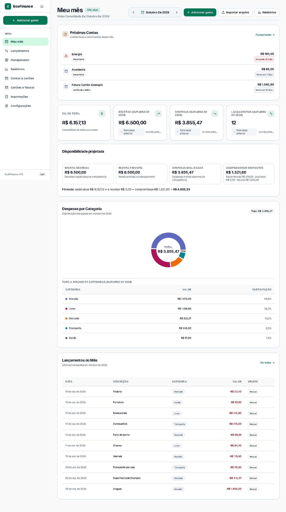
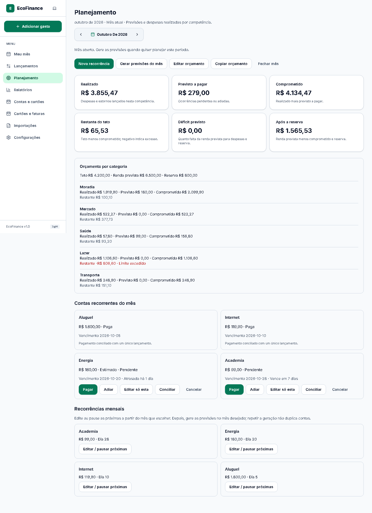
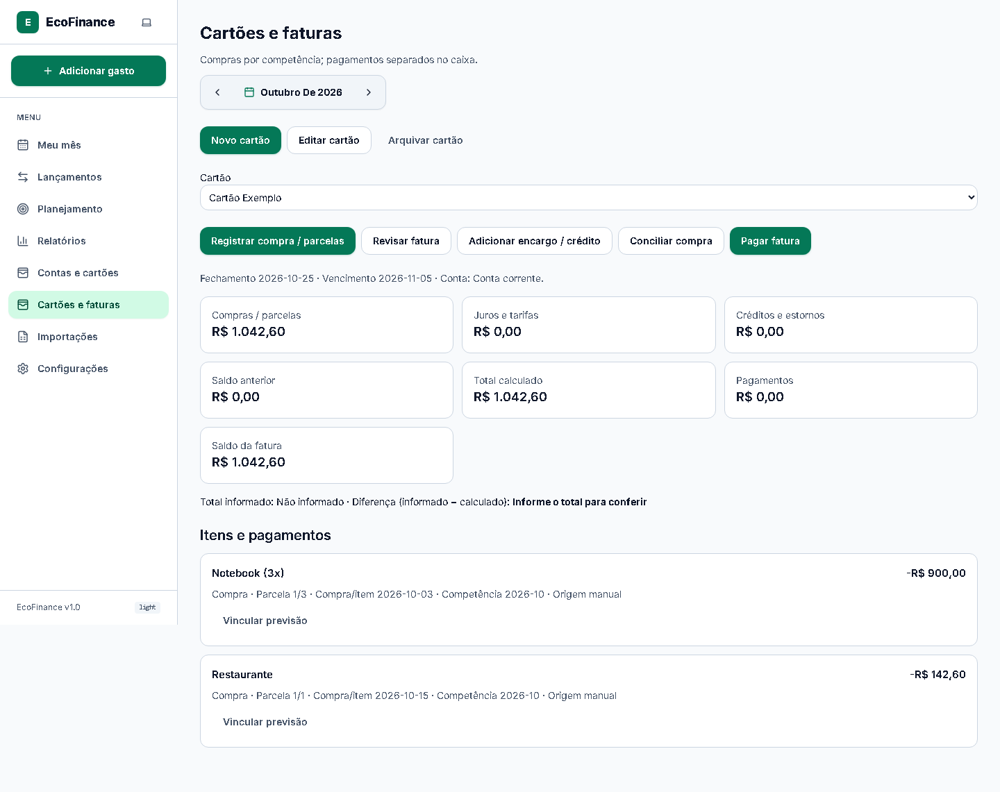
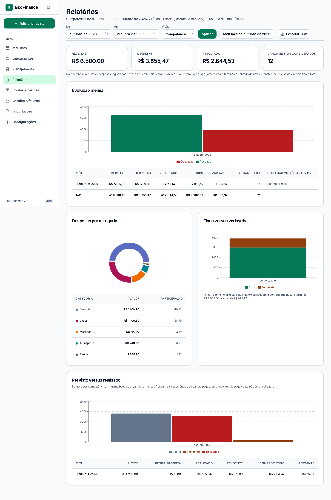
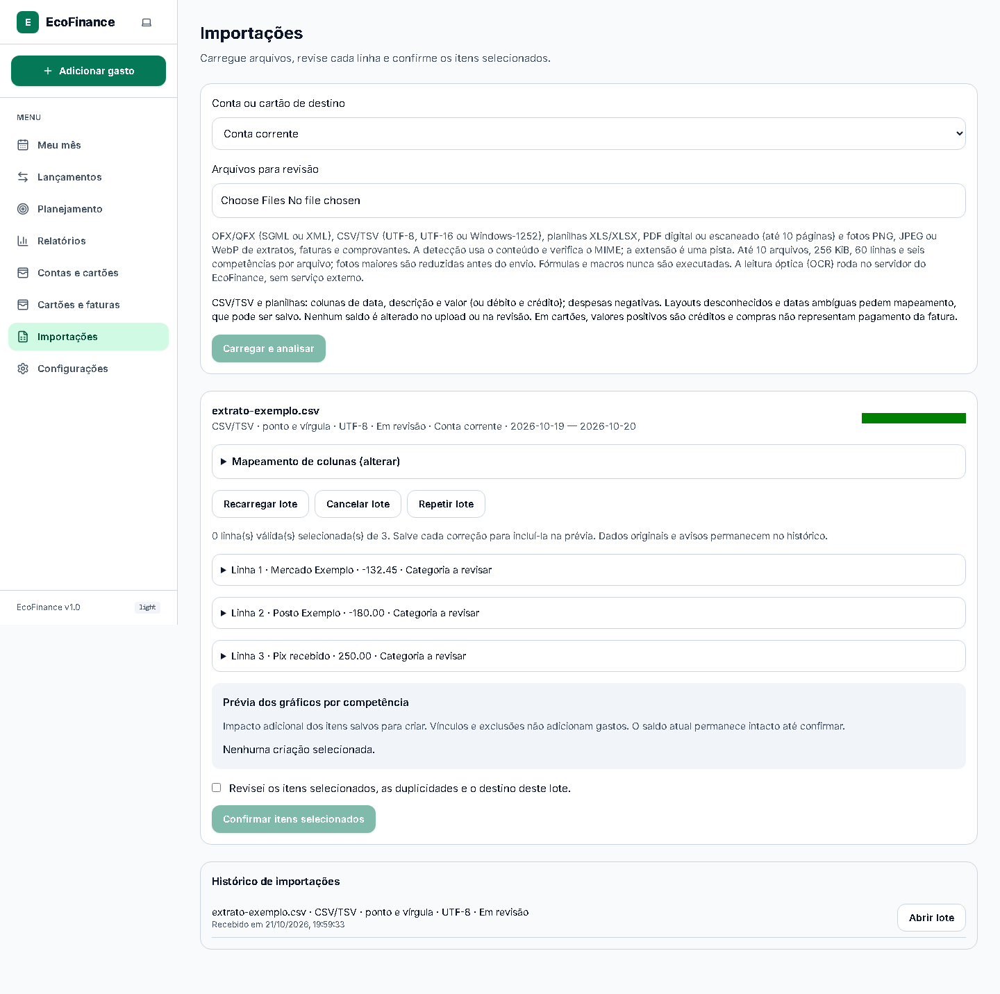
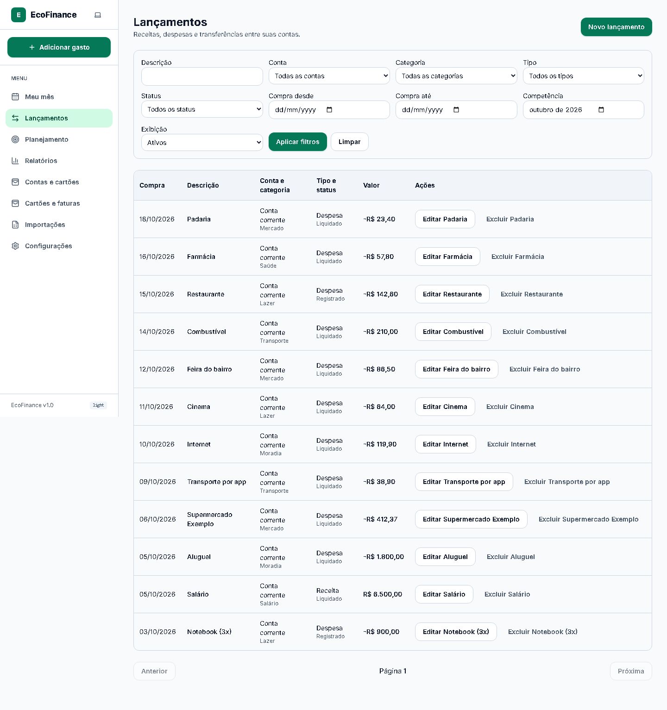
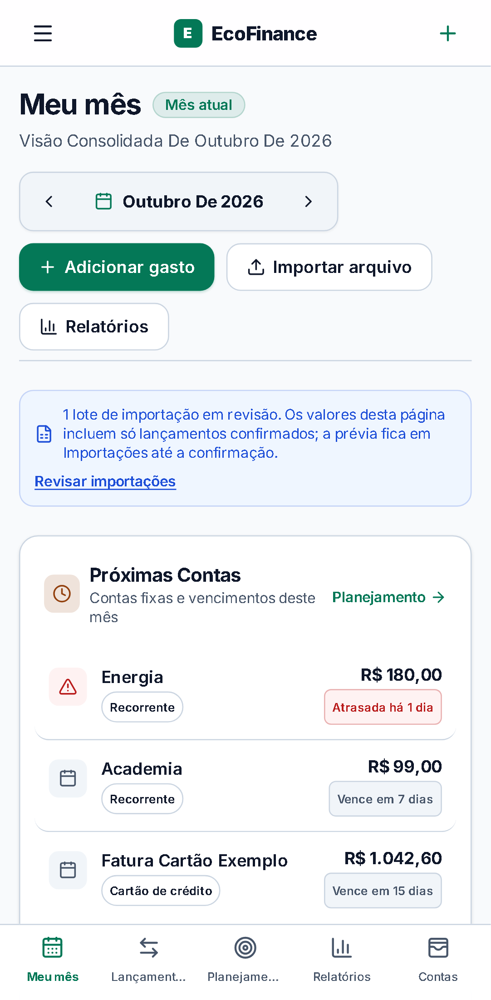

# EcoFinance

Gerenciador financeiro pessoal para planejar o mês: quanto já gastei, quanto ainda está comprometido e quanto sobra. Web responsiva em Next.js com Cloud Firestore, sem Open Finance pago nem IA externa obrigatória. O app Expo (Android/iOS) está em validação.



> **Capturas reais, dados sintéticos.** Todas as imagens deste README saíram da web local (`next start` + emulador do Firestore) com o mês fictício de [scripts/demo/seed-demo.ts](scripts/demo/seed-demo.ts) e foram geradas por [scripts/demo/capture.ts](scripts/demo/capture.ts) em 21/10/2026, a partir da `main` em `9008cdd` mais a correção de datas do PR que as publicou. Viewport desktop 1440×900 (página inteira) e celular Pixel 7 (412×839, área visível). Nenhuma conta, valor ou fatura real.

## O que está disponível

Status: **disponível** = funciona na web e é coberto por testes automatizados (domínio, integração com Firestore e E2E em Chromium, WebKit e mobile-web); **experimental** = existe, mas falta validação; **planejado** = ainda não existe.

| Recurso | Status | Detalhes |
| --- | --- | --- |
| Login por email/senha, sessões revogáveis, isolamento por usuário | Disponível | Sem cadastro público: o operador cria os acessos ([autenticação](docs/refatoracao/autenticacao.md)) |
| Meu mês: disponibilidade projetada, próximas contas, despesas por categoria | Disponível | Fórmula exibida na tela; competência e caixa separados ([métricas](docs/refatoracao/metricas.md)) |
| Contas, categorias, receitas, despesas e transferências | Disponível | Centavos exatos, exclusão reversível, saldo derivado ([cadastro manual](docs/refatoracao/cadastro-manual.md)) |
| Planejamento: recorrências, orçamento por categoria, pagar/adiar/conciliar, fechar mês | Disponível | Gerar previsões de novo não duplica contas ([planejamento](docs/refatoracao/planejamento.md)) |
| Cartões, faturas e parcelas | Disponível | Pagamento da fatura não conta como gasto de novo ([cartões](docs/refatoracao/cartoes.md)) |
| Importação com revisão: OFX/QFX, CSV/TSV, XLS/XLSX | Disponível | Nada muda nos saldos até você confirmar; desfazer protegido ([importações](docs/refatoracao/importacoes.md), [formatos](docs/refatoracao/formatos.md)) |
| PDF digital/escaneado e fotos com OCR local | Disponível | Até 10 páginas por arquivo; OCR roda no servidor e é recusado se faltar memória ([documentos](docs/refatoracao/documentos.md)) |
| Relatórios, gráficos e exportação CSV | Disponível | Os mesmos cálculos alimentam dashboard, tabelas, API e CSV |
| Backup, restauração com prévia e exclusão de dados | Disponível | [Controle de dados](docs/refatoracao/dados.md) |
| Sugestão de categoria por regras suas ou aprendidas | Disponível | Sem API externa ([assistência](docs/refatoracao/assistencia.md)) |
| Sugestão por modelo local (Ollama) | Experimental | Implementado e desligado por padrão; sem avaliação em hardware real (#11) |
| App Expo Android | Experimental | Telas nativas, cache e rascunhos por usuário; compila na CI, jornadas em aparelho pendentes ([mobile](docs/refatoracao/mobile.md), #13) |
| App Expo iOS | Experimental | Bundle gerado na CI; não executado em simulador ou aparelho, pois não há Mac disponível (#13) |
| Captura de gastos por notificações Android | Experimental | Opcional e desligada por padrão: avisos dos apps escolhidos viram sugestões em revisão; compila na CI, sem validação em aparelho ([captura](docs/refatoracao/captura.md), #19) |
| Captura de gastos por e-mail | Planejado | Viabilidade documentada; conector não implementado (#19) |
| Assistência à extração de documentos por IA | Planejado | Parsers e OCR determinísticos já funcionam sem IA (#11) |

**Removido** na transição (#15): Pluggy/Open Finance, captura antiga de notificações com GPS, mapa, recibos Uber, chat Gemini e o segredo global da API. Os lançamentos antigos continuam consultáveis e exportáveis ([transição](docs/refatoracao/transicao.md)).

## Telas

| Planejamento | Cartões e faturas |
| --- | --- |
|  |  |
| **Relatórios** | **Importação em revisão** |
|  |  |
| **Lançamentos** | **Celular (web responsiva)** |
|  |  |

## Publicar e usar

A produção roda na Vercel, região São Paulo (`gru1`), com deploy a cada push na `main`. O acesso ao Firestore não usa chave: o token OIDC da Vercel vira uma credencial temporária do Google, aceita só para o ambiente Production. Passo a passo em [docs/deploy/vercel.md](docs/deploy/vercel.md). A parte do Google cabe em um comando no Cloud Shell:

```bash
bash scripts/deploy/provision-vercel-gcp.sh --check
```

O [Cloud Run](docs/deploy/cloud-run.md) continua documentado como alternativa, com deploy manual.

Custos: o plano Hobby da Vercel é para uso pessoal, com cotas mensais, e o Firestore Enterprise exige faturamento ativo no Google. Distribuir o app nas lojas tem requisitos e custos próprios; a web responsiva funciona no celular sem instalar nada.

## Rodar localmente

Requer Node >= 22.13, pnpm 9.15 e Java 21+ (emulador do Firestore). Nenhuma chave externa é necessária.

```bash
pnpm install --frozen-lockfile
npx firebase-tools@15.32.1 emulators:start --only firestore --project demo-ecofinance
```

Em outro terminal, com `AUTH_SECRET` aleatório de 32+ caracteres (veja [.env.example](.env.example)):

```bash
pnpm --filter @ecofinance/next build
AUTH_URL=http://127.0.0.1:3000 AUTH_SECRET=... FIREBASE_PROJECT_ID=demo-ecofinance FIRESTORE_DATABASE_ID=ecofinance FIRESTORE_EMULATOR_HOST=127.0.0.1:8080 pnpm --filter @ecofinance/next start --hostname 127.0.0.1
```

Para carregar o mês de demonstração (`demo@example.test`, senha pública no script) e refazer as capturas:

```bash
FIRESTORE_EMULATOR_HOST=127.0.0.1:8080 FIREBASE_PROJECT_ID=demo-ecofinance FIRESTORE_DATABASE_ID=ecofinance pnpm exec tsx scripts/demo/seed-demo.ts
pnpm exec tsx scripts/demo/capture.ts
```

O seed recusa rodar sem o emulador. Nunca rode seed, migrações ou testes contra o projeto real.

No Expo, informe servidor, email e senha no login. O endereço pode vir de `EXPO_PUBLIC_API_URL` (público, sem segredo); fora do emulador, o app só aceita HTTPS.

## Validação

```bash
pnpm typecheck
pnpm lint
pnpm test:coverage
pnpm security:selftest
pnpm security:source
pnpm mobile:check
```

Testes com Firestore e E2E (faça o build da web antes):

```bash
npx firebase-tools@15.32.1 emulators:exec --only firestore --project demo-ecofinance "pnpm test:firebase && pnpm test:e2e"
```

[CI e gates](docs/ci-quality.md) · [estado das issues](docs/refatoracao/estado-issues.md) · [plano da refatoração](docs/refatoracao/plano.md) · [segurança](SECURITY.md)

## Organização

| Pasta | Responsabilidade |
| --- | --- |
| apps/next | Web, API, autorização e serviços de aplicação |
| apps/expo | App nativo e sessão segura |
| packages/shared | Contratos, dinheiro/calendário e regras puras |
| packages/db | Persistência Firestore, validações e exportação/recuperação |
| scripts/deploy | Provisionamento do GCP (Vercel ou Cloud Run) e primeiro acesso |
| scripts/demo | Mês sintético e capturas do README |

Contribuições: [CONTRIBUTING.md](CONTRIBUTING.md). Licença MIT.
